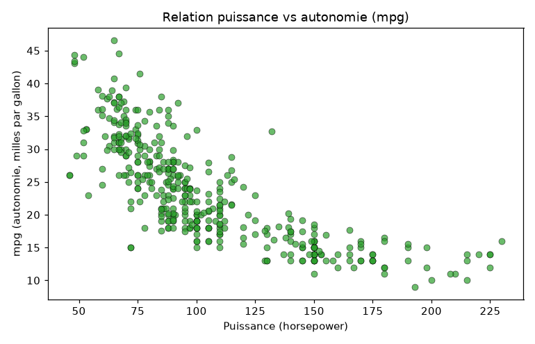
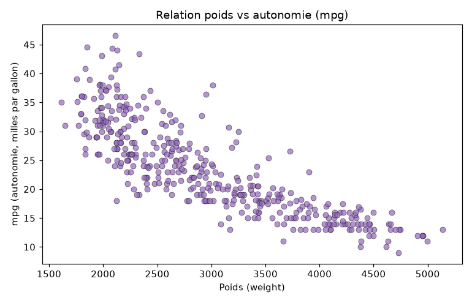
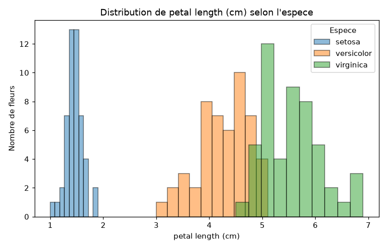
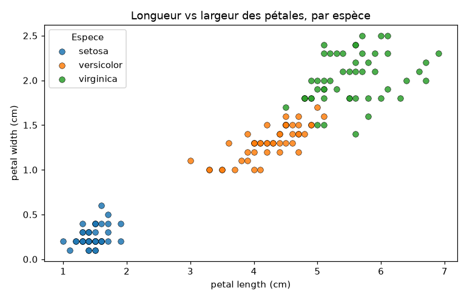
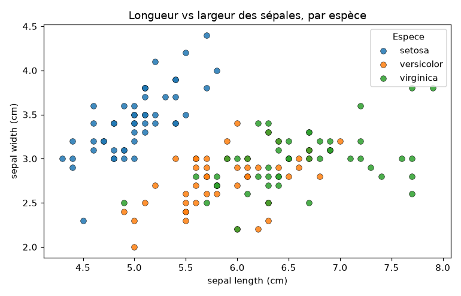

import Tabs from '@theme/Tabs';
import TabItem from '@theme/TabItem';
import useBaseUrl from '@docusaurus/useBaseUrl';
import Column from "../../src/components/Column";
import Row from "../../src/components/Row";
import RappelFonctionnementClasseInverse from '@site/docs/_components/RappelFonctionnementClasseInverse.mdx';
import DocumentationAutorisee from '@site/docs/_components/DocumentationAutorisee.mdx';
import DocumentationInterdite from '@site/docs/_components/DocumentationInterdite.mdx';
import IntroSolutionsExercices from '@site/docs/_components/IntroSolutionsExercices.mdx';
import Feedback from "../../src/components/Feedback";
import { S, N, K, F, B, C } from '@site/docs/_components/PyCode.mdx';

import Mod_DeepLearning from '../_cours-modules/_deep-learning.mdx';
import Mod_EmpreinteEcologique from '../_cours-modules/_empreinte-ecologique.mdx';
import Mod_ScikitLearn from '../_cours-modules/_scikit-learn.mdx';

# IA (types d'apprentissage, entraînement, complexité) + TP2 poursuite


:::tip Ouvrir le notebook dans Google Colab
Cliquez sur le badge pour ouvrir le notebook de cette rencontre dans [Google Colab](https://colab.research.google.com/github/Simonll/420-SN1/blob/develop/code/notebooks/13-rencontre13.ipynb) et l'exécuter sans rien installer.

<a href="https://colab.research.google.com/github/Simonll/420-SN1/blob/develop/code/notebooks/13-rencontre13.ipynb" target="_blank"></a>
:::

<Tabs queryString="onglet">

    <TabItem value="types-apprentissage" label="IA — Types d'apprentissage">

        :::info  L'idée de départ : apprendre à partir d'exemples
        En apprentissage machine, on ne programme pas les règles à la main (« si le courriel contient *gratuit*, alors c'est un pourriel »). On donne plutôt des **exemples** à un programme, et il **trouve lui-même les règles**.

        La grande question qui détermine le **type d'apprentissage** est :

        > **Est-ce que les exemples viennent avec la bonne réponse (une étiquette)?**

        - **Oui, tous** → apprentissage **supervisé**
        - **Seulement quelques-uns** → apprentissage **semi-supervisé**
        - **Aucun** → apprentissage **non supervisé**
        :::

        :::note  C'est quoi, une étiquette (*label*)?
        L'**étiquette** (*label*, ou **cible**) est la **réponse** que l'on voudrait que le modèle trouve.

        | Exemple (donnée d'entrée) | Étiquette (réponse) |
        |---------------------------|---------------------|
        | Un courriel | « pourriel » ou « normal » |
        | Une photo d'animal | « chat », « chien », « oiseau » |
        | Une maison (superficie, quartier, nb de chambres) | son prix de vente : 425 000 $ |
        | Une radiographie pulmonaire | « pneumonie » ou « saine » |

         Obtenir des étiquettes coûte souvent **cher** : il faut un humain (parfois un expert, comme un radiologue) qui regarde chaque exemple et inscrit la réponse.
        :::

        ---

        ## 1. Apprentissage supervisé 

        :::info Définition
        Le modèle apprend à partir d'exemples **tous étiquetés** : pour chaque exemple, on connaît la bonne réponse. Il apprend à associer les **entrées** à la **réponse**, pour ensuite **prédire** la réponse de nouveaux exemples.

        **Analogie** : un élève qui fait des exercices **avec le corrigé**. Après chaque exercice, il compare sa réponse à celle du corrigé et ajuste sa façon de faire.
        :::

        :::tip Les deux tâches typiques du supervisé
        | Tâche | Ce qu'on prédit | Exemples |
        |-------|-----------------|----------|
        | **Régression** | une **quantité numérique** | prix d'une maison, température de demain, consommation d'essence (L/100 km), nombre de vélos loués demain |
        | **Classification** | une **catégorie** (une classe) | pourriel / normal, chat / chien, réussite / échec, espèce d'arbre |

        **Truc pour les distinguer** : si la réponse est une **quantité** (on peut dire « un peu plus » ou « un peu moins » : prix, °C, nombre de vélos) → **régression**. Si la réponse est **un choix dans une liste** (même si on le code 0/1) → **classification**.

         **Piège de nom** : malgré son nom, la **régression logistique** est un modèle de **classification** : elle calcule une **probabilité** pour chaque classe (d'où le mot « régression »), puis choisit la classe la plus probable (ex. l'espèce d'iris, onglet Pratique).
        :::

        :::note Exemples de la vie courante
        - **Filtre anti-pourriel** : des millions de courriels marqués « pourriel » par les utilisateurs servent d'exemples étiquetés.
        - **Estimation du prix d'un logement** : on part des ventes passées (où le prix est connu).
        - **Météo** : prédire la température de demain à partir de 30 ans de relevés (dans l'historique, on connaît la « réponse » de chaque lendemain).
        - **Reconnaissance de chiffres manuscrits** (jeu de données MNIST, voir l'onglet Apprentissage profond).
        - Onglet Scikit-learn : prédire la consommation (L/100 km) d'une voiture à partir de son poids (régression).
        :::

        ---

        ## 2. Apprentissage non supervisé 

        :::info Définition
        Le modèle reçoit des exemples **sans aucune étiquette**. Personne ne lui dit quelle est la bonne réponse. Il doit **découvrir seul une structure** cachée dans les données : des groupes, des ressemblances, des cas inhabituels.

        **Analogie** : on vous donne une boîte de 500 boutons en vrac et on vous dit « classe-les ». Personne ne vous dit selon quels critères : vous allez naturellement faire des **groupes** (par couleur, taille, nombre de trous…).
        :::

        :::tip Les tâches typiques du non supervisé
        | Tâche | Ce que ça fait | Exemples |
        |-------|----------------|----------|
        | **Regroupement** (*clustering*) | former des **groupes** d'exemples qui se ressemblent | segmenter les clients d'une épicerie selon leurs achats ; regrouper des articles de nouvelles par sujet |
        | **Réduction de dimension** | **résumer** beaucoup de variables en quelques-unes, en perdant le moins d'information possible | résumer 300 mesures d'un capteur en 2 axes pour pouvoir les afficher dans un graphique |
        | **Détection d'anomalies** | repérer les exemples **qui ne ressemblent à aucun autre** | transaction bancaire inhabituelle, capteur défectueux |
        :::

        :::warning Piège fréquent
        Un algorithme de regroupement trouve des groupes, mais **il ne sait pas les nommer**. Il dira « groupe 1, groupe 2, groupe 3 ». C'est **un humain** qui interprète ensuite : « le groupe 2, ce sont les familles qui achètent en grande quantité ».

        Et comme il n'y a pas de « bonne réponse », on ne peut pas calculer d'exactitude (*accuracy*) comme en supervisé.
        :::

        ---

        ## 3. Apprentissage semi-supervisé 

        :::info Définition
        Le modèle apprend à partir d'un **petit nombre d'exemples étiquetés** et d'un **grand nombre d'exemples non étiquetés**. Le but reste le même qu'en supervisé : **prédire une réponse** (classification ou régression). Les exemples non étiquetés aident le modèle à mieux comprendre la « forme » des données.

        **Quand l'utiliser?** Quand **les données sont faciles à obtenir, mais les étiquettes coûtent cher** (temps, argent, expertise).

        **Analogie** : un élève qui a **10 exercices corrigés** et **500 exercices sans corrigé**. Il apprend la méthode avec les 10 corrigés, puis s'exerce sur les autres. Quand il est très sûr d'une réponse, il la considère comme bonne et continue à apprendre avec elle.
        :::

        :::tip Un mécanisme simple : le pseudo-étiquetage
        ```mermaid
        flowchart LR
            A[" Petit lot étiqueté<br/><sub>ex. 200 radiographies<br/>annotées par un radiologue</sub>"] --> B[" Entraîner un<br/>premier modèle"]
            B --> C[" Prédire sur le grand lot<br/>non étiqueté<br/><sub>ex. 20 000 radiographies</sub>"]
            C --> D[" Garder seulement les prédictions<br/>dont le modèle est très sûr<br/><sub>= pseudo-étiquettes</sub>"]
            D --> E[" Ajouter ces exemples<br/>au lot étiqueté"]
            E --> B
        ```
        On répète la boucle : le lot étiqueté grossit, et le modèle s'améliore sans qu'un humain ait à tout annoter.
        :::

        :::note Exemples de la vie courante
        - **Application de photos** : vous identifiez votre chat sur 5 photos, et l'application le retrouve dans vos 3 000 autres photos.
        - **Imagerie médicale** : quelques centaines d'images annotées par des spécialistes, des dizaines de milliers d'images non annotées.
        - **Reconnaissance vocale** : quelques heures d'audio transcrites à la main, des milliers d'heures d'audio brut.
        - **Biologie** : 50 enregistrements de chants d'oiseaux identifiés par un ornithologue, 10 000 enregistrements non identifiés.
        :::

        ---

        ##  Tableau comparatif (à connaître pour l'examen)

        :::info Supervisé vs semi-supervisé vs non supervisé
        | | **Supervisé** | **Semi-supervisé** | **Non supervisé** |
        |---|---|---|---|
        | **Données d'entrée** | toutes **étiquetées** | **quelques-unes** étiquetées + **beaucoup** non étiquetées | **aucune** étiquette |
        | **Objectif** | prédire une réponse connue | prédire une réponse connue, avec peu d'étiquettes | découvrir une structure cachée |
        | **Tâches typiques** | régression, classification | classification (surtout), régression | regroupement (*clustering*), réduction de dimension, détection d'anomalies |
        | **Peut-on mesurer l'exactitude?** | oui (on connaît les réponses) | oui (sur les exemples étiquetés de test) | pas directement (pas de réponse connue) |
        | **Quand l'utiliser?** | étiquettes disponibles en quantité | étiqueter coûte cher (expert, temps) | pas d'étiquettes, ou on explore les données |
        | **Analogie** | exercices **avec corrigé** | **quelques** exercices corrigés + beaucoup sans corrigé | trier une boîte de boutons **sans consigne** |
        | **Exemple** | filtre anti-pourriel | retrouver son chat dans ses photos | segmenter des clients |
        :::

        :::tip  Méthode en 2 questions pour classer une situation
        ```mermaid
        flowchart TD
            Q1{"Les exemples ont-ils<br/>une étiquette (la réponse)?"}
            Q1 -->|"Oui, tous"| S[" Supervisé"]
            Q1 -->|"Seulement une petite partie"| SS[" Semi-supervisé"]
            Q1 -->|"Aucun"| NS[" Non supervisé"]
            S --> Q2{"La réponse est…"}
            Q2 -->|"une quantité numérique"| R["Régression"]
            Q2 -->|"un choix dans une liste<br/>(une catégorie)"| C["Classification"]
        ```
        :::

        :::note Pour la culture (non évalué)
        Il existe un 4ᵉ grand type : l'**apprentissage par renforcement**. Le modèle (un « agent ») apprend par **essais et erreurs**, en recevant des **récompenses** ou des **pénalités** (ex. une IA qui apprend à jouer aux échecs ou un robot qui apprend à marcher). Il n'est pas au programme de l'examen.
        :::

    </TabItem>

    <TabItem value="entrainement" label="IA — Entraîner un modèle">

        :::info  Qu'est-ce qu'un modèle?
        Un **modèle** est une sorte de **fonction** : on lui donne des **entrées**, il produit une **sortie** (une prédiction).

        Ce qui le rend « intelligent », c'est qu'il possède des **paramètres** (des nombres réglables, comme la pente et l'ordonnée à l'origine d'une droite, ou les poids d'un neurone) et que ces paramètres sont **ajustés automatiquement à partir d'exemples**. C'est ce qu'on appelle l'**entraînement**.

        Rappel (onglet Scikit-learn) : une régression linéaire `L/100 km = 0.00408 × poids − 0.903` est un modèle ; ses deux paramètres (0.00408 et −0.903) ont été trouvés par l'entraînement.
        :::

        ---

        ## 1. Le vocabulaire de base

        :::tip Exemple fil rouge : reconnaître des fruits 
        On veut un modèle qui reconnaît si un fruit est une **pomme** ou une **orange**, à partir de son poids et de sa couleur. Voici nos données :

        | Poids (g) | Couleur (0 = rouge, 1 = orange) | Rugosité de la peau (0 à 10) | **Fruit** |
        |-----------|-------------------------------|------------------------------|-----------|
        | 150 | 0 | 1 | **pomme** |
        | 170 | 0 | 2 | **pomme** |
        | 140 | 1 | 7 | **orange** |
        | 130 | 1 | 8 | **orange** |
        | … | … | … | … |

        Avec ce tableau, on peut nommer chaque morceau :

        | Terme | Définition simple | Dans l'exemple |
        |-------|-------------------|----------------|
        | **Exemple** (observation) | une ligne du tableau | un fruit |
        | **Caractéristique** (*feature*, variable d'entrée) | une information **donnée au modèle** pour décider | poids, couleur, rugosité |
        | **Étiquette** (*label*, cible) | la **réponse** que le modèle doit trouver | « pomme » ou « orange » |
        | **Modèle** | la « fonction » qui transforme les caractéristiques en prédiction | la règle apprise |
        | **Paramètres** | les nombres internes réglés pendant l'entraînement | les poids d'un neurone, la pente d'une droite |
        | **Entraînement** (*fit*) | la phase où le modèle **ajuste ses paramètres** à partir des données (en **supervisé** : caractéristiques **et** étiquettes ; en **non supervisé** : caractéristiques seulement) | le modèle regarde les fruits connus |
        | **Inférence** (prédiction, *predict*) | la phase où le modèle **déjà entraîné** donne une réponse pour un **nouvel exemple** | un fruit inconnu arrive : « c'est une orange » |
        | **Hyperparamètre** | un **réglage choisi par l'humain avant** l'entraînement ; il n'est **pas** appris par *fit* ; on le choisit avec l'ensemble de **validation** | le degré d'une courbe, le nombre de couches ou de neurones, le nombre d'époques, la force de la régularisation |

        Par convention, on note **X** les caractéristiques (un tableau 2D : une ligne par exemple, une colonne par caractéristique) et **y** les étiquettes (une colonne : une réponse par exemple).
        :::

        :::warning Ne pas confondre paramètre et hyperparamètre
        | | **Paramètre** | **Hyperparamètre** |
        |---|---|---|
        | **Qui le fixe?** | le modèle, **automatiquement** pendant l'entraînement (*fit*) | **l'humain**, **avant** l'entraînement |
        | **Exemples** | pente et ordonnée d'une droite, poids et biais d'un neurone | degré de la courbe, nombre de couches/neurones, nombre d'époques, force de la régularisation |
        | **Avec quelles données?** | l'ensemble d'**entraînement** | l'ensemble de **validation** (on compare plusieurs réglages) |

        Les hyperparamètres sont justement les **leviers** qui contrôlent la complexité d'un modèle (voir l'onglet Complexité).
        :::

        :::warning Ne pas confondre entraînement et inférence
        | | Entraînement (*fit*) | Inférence (*predict*) |
        |---|---|---|
        | **Quand?** | une fois (ou de temps en temps), **avant** l'utilisation | à chaque utilisation |
        | **Données utilisées** | en **supervisé** : caractéristiques **et** étiquettes ; en **non supervisé** : caractéristiques seulement | caractéristiques **seulement** (on ne connaît pas la réponse) |
        | **Les paramètres changent?** | **oui**, c'est le but | **non**, ils sont figés |
        | **Coût** | long et coûteux (peut prendre des semaines pour un grand modèle) | rapide pour **une** prédiction (mais il y en a des millions, voir l'onglet Empreinte écologique) |
        | **Exemple** | Ton application apprend à partir de 10 000 photos étiquetées | Tu prends une photo, l'application te dit « chat » |
        :::

        ---

        ## 2. Comment un modèle apprend-il? (le mécanisme)

        :::info La boucle d'apprentissage : essayer, se tromper, corriger
        L'entraînement est une **boucle** qui se répète des milliers de fois :

        ```mermaid
        flowchart LR
            A["1 Prédire<br/><sub>avec les paramètres actuels</sub>"] --> B["2 Comparer<br/><sub>prédiction vs vraie réponse<br/>→ calculer l'erreur</sub>"]
            B --> C["3 Ajuster<br/><sub>modifier un peu les paramètres<br/>pour réduire l'erreur</sub>"]
            C --> A
        ```

        1. Au départ, les paramètres sont **choisis au hasard** : le modèle répond n'importe quoi.
        2. Pour chaque exemple, on **compare** sa prédiction à la vraie réponse (l'étiquette) : c'est l'**erreur** (aussi appelée **perte**, *loss*).
        3. On **modifie légèrement** les paramètres dans la direction qui **diminue** l'erreur.
        4. On recommence. Un passage complet sur toutes les données d'entraînement s'appelle une **époque** (*epoch*).

        **Analogie** : régler l'eau de la douche. Trop froide → on tourne un peu vers le chaud. Trop chaude → un peu vers le froid. On répète jusqu'à ce que ce soit bon. Le modèle fait la même chose avec ses paramètres.

        C'est exactement ce que fait le **perceptron** de l'onglet Apprentissage profond : `err = cible - pred`, puis `w += lr * err * x`.
        :::

        ---

        ## 3. Séparer les données : entraînement (train) et test

        :::info Pourquoi évaluer sur des données que le modèle n'a jamais vues?
        Ce qu'on veut d'un modèle, ce n'est pas qu'il réponde bien sur les exemples **qu'il connaît déjà**, mais sur de **nouveaux** exemples. C'est ce qu'on appelle **généraliser**.

        **Analogie de l'examen** : si l'examen final contient **exactement** les mêmes questions que l'examen formatif, un élève qui a appris les réponses par cœur aura 100 %… sans rien avoir compris. Pour savoir si quelqu'un a **vraiment** compris, il faut lui poser des questions **qu'il n'a jamais vues**.

        On sépare donc les données étiquetées **avant** l'entraînement :

        ```mermaid
        flowchart LR
            D[" Toutes les données étiquetées<br/>(100 %)"] --> T[" Ensemble d'entraînement (train)<br/>≈ 80 %<br/><sub>sert à ajuster les paramètres (fit)</sub>"]
            D --> E[" Ensemble de test<br/>≈ 20 %<br/><sub>mis de côté, utilisé une seule fois<br/>à la fin pour évaluer</sub>"]
        ```

        **Règle d'or** : le modèle ne doit **jamais** voir les données de test pendant l'entraînement. Sinon, l'évaluation est « truquée », comme si l'élève avait vu l'examen d'avance.
        :::

        :::note Et l'ensemble de validation (vu en R12)?
        En R12, on a séparé les données en **trois** : entraînement, **validation** et test. La validation sert à **choisir les réglages** du modèle, appelés **hyperparamètres** (par exemple sa complexité, voir l'onglet suivant), **sans toucher au test**. Résumé : **entraînement = ajuster**, **validation = choisir**, **test = confirmer une seule fois** à la fin. Le principe reste le même : évaluer sur des données non utilisées pour ajuster les paramètres.
        :::

        ---

        ## 4. Mesurer la performance : l'exactitude (*accuracy*)

        :::info Définition
        Pour une tâche de **classification**, l'**exactitude** (*accuracy*) est :

        $$
        \text{exactitude} = \frac{\text{nombre de bonnes prédictions}}{\text{nombre total de prédictions}}
        $$

        **Exemple** : sur 200 fruits de l'ensemble de test, le modèle en reconnaît correctement 180. Exactitude = 180 / 200 = **0,90**, soit **90 %**.

        Pour une **régression**, on ne parle pas de « bonne » ou « mauvaise » réponse, mais de **distance** entre la valeur prédite et la vraie valeur : on utilise le **coefficient de détermination** R².

        $$
        R^2 = 1 - \frac{\sum (y_i - \hat{y}_i)^2}{\sum (y_i - \bar{y})^2}
        $$

        - $y_i$ : la vraie valeur ; $\hat{y}_i$ : la prédiction ; $\bar{y}$ : la moyenne des vraies valeurs ;
        - **R² = 1** : prédictions parfaites ; **R² = 0** : pas mieux que de prédire la moyenne ; sur le **test**, R² peut être **négatif** (le modèle fait pire que la moyenne).
        :::

        :::tip Documentation scikit-learn
        Les fonctions vues ici (exactitude, R²) ont leurs pages de référence officielles :
        - [`accuracy_score` — exactitude](https://scikit-learn.org/stable/modules/generated/sklearn.metrics.accuracy_score.html)
        - [`r2_score` — coefficient de détermination R²](https://scikit-learn.org/stable/modules/generated/sklearn.metrics.r2_score.html)
        :::

        :::warning Piège : une exactitude élevée n'est pas toujours bonne
        Un détecteur de fraude est testé sur 1 000 transactions, dont **990 honnêtes** et **10 frauduleuses**. Un « modèle » paresseux qui répond **toujours « honnête »** obtient :

        exactitude = 990 / 1 000 = **99 %**… et il n'a **détecté aucune fraude**!

         Quand une classe est beaucoup plus fréquente que l'autre, l'exactitude seule peut être trompeuse. Il faut regarder aussi si le modèle trouve les cas rares.
        :::

        ---

        ## 5. Sous-apprentissage et sur-apprentissage

        :::info Les deux façons de rater un apprentissage
        | | **Sous-apprentissage** (*underfitting*) | **Bon apprentissage** | **Sur-apprentissage** (*overfitting*) |
        |---|---|---|---|
        | **En une phrase** | le modèle est **trop simple**, il n'a pas saisi la tendance | le modèle a saisi la **tendance générale** | le modèle a **appris par cœur** les exemples, y compris le bruit |
        | **Score d'entraînement** | **faible** | bon | **très élevé** (souvent près de 100 %) |
        | **Score de test** | **faible** (proche du score d'entraînement) | bon (proche du score d'entraînement) | **nettement plus faible** que le score d'entraînement |
        | **Analogie étudiante** | n'a lu que les titres du chapitre : échoue au formatif **et** à l'examen | a compris la méthode : réussit le formatif **et** l'examen | a mémorisé les réponses du formatif : 100 % au formatif, échoue à l'examen |
        | **Analogie fruits** | « tout ce qui pèse plus de 100 g est une pomme » | utilise couleur + rugosité | « une pomme pèse exactement 150 g ou 170 g » |
        :::

        :::tip  Le diagnostic : comparer entraînement et test
        C'est **l'écart entre le score d'entraînement et le score de test** qui permet de poser le diagnostic :

        | Score (entraînement) | Score (test) | Diagnostic |
        |-------------|------------|------------|
        | 60 % | 58 % | **Sous-apprentissage** : les deux sont faibles |
        | 92 % | 89 % | **Bonne généralisation** : les deux sont bons et proches |
        | 100 % | 65 % | **Sur-apprentissage** : grand écart en faveur de l'entraînement |

        **« Faible » par rapport à quoi?** Pour juger un score, comparez-le à un **modèle de base** : le **hasard**. Avec **2 classes équilibrées** (50 % / 50 %), répondre au hasard donne déjà environ **50 %**. Un modèle à 52 % ne fait donc presque pas mieux que le hasard ; 60 % est faible, 90 % est bon.

         Un score de 100 % sur les données d'entraînement **ne prouve rien** : c'est même souvent un **signal d'alarme** de sur-apprentissage. Seul le score sur le **test** indique si le modèle généralise.
        :::

    </TabItem>

    <TabItem value="pratique" label="IA — Pratique : Iris & mpg (distribution puis modélisation)">

        :::info Objectif de l'exercice guidé
        Avant d'entraîner un modèle, un analyste **regarde toujours ses données**. Cette étape s'appelle l'**analyse exploratoire des données** (en anglais *EDA*, pour *Exploratory Data Analysis*).

        La règle à retenir pour cet exercice :

        > **1. Décrire la distribution des variables → 2. Modéliser → 3. Interpréter.**

        Pourquoi? Parce qu'une variable avec des **valeurs manquantes**, des **valeurs extrêmes** (*outliers*) ou une forme très asymétrique peut fausser un modèle. Si on ne regarde pas les données, on ne le saura jamais.
        :::

        :::note Les deux jeux de données utilisés
        | Jeu de données | Contenu | Ce qu'on veut prédire | Type de problème | Modèle |
        |---|---|---|---|---|
        | **mpg** | 398 voitures (puissance, poids, cylindres, etc.) | l'**autonomie en carburant** `mpg` (milles par gallon, *miles per gallon*) : un **nombre** (plus il est élevé, moins la voiture consomme) | **régression** | régression **linéaire** |
        | **Iris** | 150 fleurs (longueur et largeur des sépales et des pétales) | l'**espèce** de la fleur : une **catégorie** parmi 3 | **classification** | régression **logistique** |

        Créez un fichier `pratique_ia.py` (ou un notebook) et exécutez les morceaux de code **un à la fois**, dans l'ordre.
        :::tip Documentation scikit-learn
        Les fonctions utilisées dans cet exercice ont leur page officielle (utilisable hors examen, pour comprendre la doc) :
        - [`LinearRegression`](https://scikit-learn.org/stable/modules/generated/sklearn.linear_model.LinearRegression.html)
        - [`LogisticRegression`](https://scikit-learn.org/stable/modules/generated/sklearn.linear_model.LogisticRegression.html)
        - [`train_test_split`](https://scikit-learn.org/stable/modules/generated/sklearn.model_selection.train_test_split.html)
        - [`accuracy_score`](https://scikit-learn.org/stable/modules/generated/sklearn.metrics.accuracy_score.html) et [`r2_score`](https://scikit-learn.org/stable/modules/generated/sklearn.metrics.r2_score.html)
        :::
 Lisez les sorties avant de passer au suivant et répondez aux questions.
        :::

        :::warning Attention : mpg ≠ L/100 km (sens inverse)
        `mpg` mesure la **distance** parcourue avec un gallon d'essence : **plus le mpg est élevé, moins la voiture consomme**. C'est le **sens inverse** de la consommation en L/100 km (onglet Scikit-learn), où une valeur élevée veut dire que la voiture consomme **plus**.

        Exemple : 30 mpg ≈ 7,8 L/100 km (voiture économe) ; 15 mpg ≈ 15,7 L/100 km (voiture gourmande).
        :::

        ---

        ## Partie A — Charger les données et décrire la distribution des variables

        ### A.1 Charger les deux jeux de données

        Téléchargez le fichier <a href={useBaseUrl('/ressources/csv/mpg_dataset.csv')} download="mpg_dataset.csv">mpg_dataset.csv</a> et placez-le dans le même dossier que votre script. Le jeu de données **Iris**, lui, est fourni directement par scikit-learn : aucun fichier à télécharger.

        ```python
        import pandas as pd
        import matplotlib.pyplot as plt
        from sklearn.datasets import load_iris

        # --- Jeu de données mpg (fichier CSV) ---
        df_mpg = pd.read_csv("mpg_dataset.csv")

        # --- Jeu de données Iris (fourni par scikit-learn) ---
        iris = load_iris(as_frame=True)   # as_frame=True : on obtient un DataFrame Pandas
        df_iris = iris.frame              # 4 mesures + une colonne "target" (0, 1 ou 2)

        # On remplace les codes 0, 1, 2 par le nom de l'espèce (plus lisible)
        df_iris["espece"] = df_iris["target"].map({0: "setosa", 1: "versicolor", 2: "virginica"})

        print(df_mpg.head())
        print(df_iris.head())
        ```

        ### A.2 Première vue d'ensemble : `info()`, `describe()`, données manquantes

        ```python
        # Nombre de lignes, nom et type de chaque colonne, nombre de valeurs non nulles
        df_mpg.info()

        # Nombre de valeurs manquantes par colonne
        print(df_mpg.isnull().sum())

        # Statistiques descriptives des colonnes numériques
        print(df_mpg.describe())
        ```

        :::tip Valeurs manquantes dans `horsepower` (la puissance)
        La sortie de `isnull().sum()` montre que la colonne `horsepower` contient **quelques valeurs manquantes** (6 voitures). Un modèle scikit-learn **refuse** les valeurs manquantes : il faut s'en occuper **avant** de modéliser.

        La solution la plus simple ici : **retirer les lignes incomplètes** avec `dropna`.

        ```python
        print("Avant :", len(df_mpg), "lignes")
        df_mpg = df_mpg.dropna(subset=["horsepower"])   # retire les lignes où horsepower est vide
        print("Après :", len(df_mpg), "lignes")
        ```

        Retirer 6 lignes sur 398 est acceptable. Si la moitié des lignes étaient vides, il faudrait une autre stratégie (par exemple `fillna` avec la médiane).
        :::

        Faites la même vérification pour Iris :

        ```python
        df_iris.info()
        print(df_iris.isnull().sum())
        print(df_iris.describe())
        ```

        ### A.3 Variables continues ou catégorielles?

        Avant de tracer quoi que ce soit, il faut savoir **de quel type** est chaque variable, car on ne la décrit pas de la même façon.

        | Type de variable | Définition | Exemples dans mpg | Exemples dans Iris | Comment la décrire |
        |---|---|---|---|---|
        | **Continue** (quantitative) | un nombre qui peut prendre beaucoup de valeurs | `mpg`, `horsepower`, `weight`, `acceleration`, `displacement` | les 4 mesures en cm | `describe()`, **histogramme**, **diagramme en boîte** |
        | **Catégorielle** | un petit nombre de catégories (texte ou codes) | `origin` (usa, europe, japan), `cylinders` (3, 4, 5, 6, 8) | `espece` | `value_counts()`, diagramme à barres |

        ```python
        # Pour une variable catégorielle : on compte les valeurs
        print(df_mpg["origin"].value_counts())
        print(df_mpg["cylinders"].value_counts())
        print(df_iris["espece"].value_counts())
        ```

        :::note Attention aux pièges
        - `cylinders` est stockée comme un **nombre**, mais elle ne prend que 5 valeurs : on la traite plutôt comme une variable **catégorielle**.
        - `name` (le nom du modèle de voiture) est un **identifiant** : presque chaque ligne a une valeur différente. On ne l'utilise pas pour modéliser.
        - Dans Iris, les 3 espèces sont **équilibrées** (50 fleurs chacune). Avec 3 classes équilibrées, répondre au hasard donne environ **33 %** d'exactitude : c'est notre point de comparaison pour la partie C.
        :::

        ### A.4 Décrire la distribution d'une variable continue : l'histogramme

        Un **histogramme** découpe les valeurs en intervalles (les **classes**, ou *bins*) et compte combien de lignes tombent dans chaque intervalle. Il montre la **forme** de la distribution.

        ```python
        # Histogramme de l'autonomie mpg
        plt.hist(df_mpg["mpg"], bins=20, edgecolor="black")
        plt.title("Distribution de mpg")
        plt.xlabel("mpg (milles par gallon)")
        plt.ylabel("Nombre de voitures")
        plt.show()
        ```

        :::tip Bien choisir le nombre de classes (`bins`)
        Le paramètre `bins` fixe le **nombre d'intervalles**.
        - **Trop peu** (ex. `bins=3`) : tout est écrasé, on ne voit plus la forme.
        - **Trop** (ex. `bins=200`) : l'histogramme devient « en dents de scie », on voit surtout du bruit.
        - Entre **10 et 30** convient en général pour quelques centaines de lignes.

        Essayez `bins=3`, `bins=20` et `bins=200` sur le même graphique et comparez.
        :::

        Pour aller plus vite, Pandas peut tracer **tous les histogrammes d'un coup** :

        ```python
        # Un histogramme par colonne numérique
        df_mpg.hist(bins=20, figsize=(12, 8), edgecolor="black")
        plt.tight_layout()
        plt.show()

        df_iris.drop(columns="target").hist(bins=15, figsize=(10, 6), edgecolor="black")
        plt.tight_layout()
        plt.show()
        ```

        Exemple de rendu (histogrammes de `mpg` et de la puissance) :

        

        :::info Comment lire la forme d'une distribution
        | Ce qu'on observe | Vocabulaire | Indice dans `describe()` |
        |---|---|---|
        | une seule « bosse » au milieu, à peu près symétrique | distribution **centrée**, **symétrique** | moyenne (`mean`) ≈ médiane (`50%`) |
        | une longue « queue » vers la **droite** (quelques grandes valeurs) | **asymétrie à droite** | moyenne **plus grande** que la médiane |
        | une longue « queue » vers la **gauche** | **asymétrie à gauche** | moyenne **plus petite** que la médiane |
        | les valeurs couvrent un grand intervalle | distribution **étalée** | grand écart-type (`std`), grand écart entre `min` et `max` |
        | deux « bosses » séparées | distribution **bimodale** (souvent : deux groupes mélangés) | difficile à voir sans graphique |
        :::

        ### A.5 Repérer les valeurs extrêmes : le diagramme en boîte (*boxplot*)

        Le **diagramme en boîte** (ou boîte à moustaches, *boxplot*) résume une variable autour de ses quartiles : la boîte va du 1er quartile (Q1, `25%`) au 3e quartile (Q3, `75%`), avec un trait à la médiane (`50%`). Les « moustaches » s'étendent jusqu'aux valeurs les plus éloignées situées à moins de 1,5 × (Q3 − Q1) de la boîte (Q3 − Q1 s'appelle l'écart interquartile). Au-delà, les **points isolés** sont des **valeurs extrêmes** potentielles (*outliers*). S'il n'y a aucun point isolé, les moustaches vont jusqu'au minimum et au maximum.

        ```python
        # Diagrammes en boîte de quelques variables de mpg
        df_mpg.boxplot(column=["mpg", "acceleration"])
        plt.title("Diagrammes en boîte : mpg et accélération")
        plt.show()

        df_mpg.boxplot(column="horsepower")
        plt.title("Diagramme en boîte : puissance (horsepower)")
        plt.show()
        ```

        :::note Une valeur extrême n'est pas une erreur
        Une voiture de 230 chevaux est **rare**, mais elle **existe**. On ne supprime pas une valeur extrême sans raison : on la **remarque** et on se demande si elle est plausible. On ne retire que les valeurs **impossibles** (ex. un poids négatif).
        :::

        ### A.6 Questions d'interprétation (Partie A)

        Répondez en commentaire dans votre script (`# Réponse : ...`).

        1. Combien de lignes contient `df_mpg` **avant** et **après** le `dropna`? Combien de valeurs manquantes y avait-il, et dans quelle colonne?
        2. Parmi `mpg`, `horsepower` et `weight`, quelle variable est la plus **asymétrique**? Vers quel côté? Comparez la moyenne et la médiane dans `describe()` pour confirmer.
        3. Dans Iris, quelle mesure est la plus **étalée** (le plus grand `std`)? Quelle mesure est la moins étalée?
        4. L'histogramme de la longueur des pétales (`petal length (cm)`) a-t-il **une** ou **deux** bosses? Selon vous, qu'est-ce que cela pourrait signifier? (Indice : il y a plusieurs espèces dans le jeu de données.)
        5. Y a-t-il des **valeurs extrêmes** dans `horsepower`? Dans `acceleration`? Vous semblent-elles plausibles?
        6. Classez chaque colonne de `df_mpg` comme **continue**, **catégorielle** ou **identifiant**.

        ---

        ## Partie B — Régression linéaire : prédire `mpg` (jeu de données mpg)

        :::info Le problème
        On veut **prédire l'autonomie `mpg`** (un **nombre continu**) d'une voiture à partir de **sa puissance** (*horsepower*, en chevaux). C'est un problème de **régression** supervisée :
        - **caractéristique** (entrée, `X`) : la puissance (`horsepower`)
        - **étiquette** ou cible (sortie, `y`) : `mpg`

        Le modèle cherche la droite `mpg = a × horsepower + b` qui passe **le plus près possible** des points.
        :::

        ### B.1 Observer la relation avant de modéliser

        On a déjà décrit l'autonomie `mpg` et la puissance `horsepower` **séparément** (Partie A). Regardons maintenant **les deux ensemble** avec un nuage de points.

        ```python
        plt.scatter(df_mpg["horsepower"], df_mpg["mpg"], alpha=0.5)
        plt.title("mpg en fonction de la puissance (horsepower)")
        plt.xlabel("puissance (chevaux)")
        plt.ylabel("mpg (milles par gallon)")
        plt.show()
        ```

        :::tip Questions à se poser devant le nuage
        - La tendance **monte** ou **descend**? (Plus de puissance → plus ou moins de milles par gallon?)
        - Les points forment-ils à peu près une **droite**, ou plutôt une **courbe**?
        - Les points sont-ils **serrés** autour de la tendance, ou très **dispersés**?
        :::


        Un exemple de rendu : plus la puissance augmente, plus le mpg **baisse** — le poids a lui aussi une relation décroissante avec l'autonomie :

        

        

        ### B.2 Séparer les données : entraînement et test

        Comme vu dans l'onglet « IA — Entraîner un modèle » : on entraîne sur une partie des données (ensemble d'**entraînement**) et on évalue sur une partie **jamais vue** (ensemble de **test**).

        ```python
        from sklearn.model_selection import train_test_split

        X = df_mpg[["horsepower"]]   # double crochet : X doit être un tableau à 2 dimensions (un DataFrame)
        y = df_mpg["mpg"]            # simple crochet : y est une seule colonne (une Series)

        # 80 % pour l'entraînement, 20 % pour le test
        # random_state=42 : le découpage est le même à chaque exécution (résultats reproductibles)
        X_train, X_test, y_train, y_test = train_test_split(X, y, test_size=0.2, random_state=42)

        print("Train :", len(X_train), "voitures")
        print("Test  :", len(X_test), "voitures")
        ```

        ### B.3 Entraîner le modèle et lire ses paramètres

        ```python
        from sklearn.linear_model import LinearRegression

        modele_lin = LinearRegression()
        modele_lin.fit(X_train, y_train)     # entraînement : le modèle trouve a et b

        a = modele_lin.coef_[0]      # la pente
        b = modele_lin.intercept_    # l'ordonnée à l'origine
        print("Pente a =", round(a, 4))
        print("Ordonnée à l'origine b =", round(b, 2))
        print(f"Modèle : mpg = {a:.4f} × horsepower + {b:.2f}")
        ```

        ### B.4 Prédire à la main, puis avec le modèle

        Le modèle n'est rien d'autre qu'une **formule**. Vérifions-le en calculant une prédiction **nous-mêmes**.

        ```python
        puissance = 100   # une voiture de 100 chevaux

        # 1) Prédiction à la main avec la formule mpg = a × X + b
        mpg_main = a * puissance + b
        print("Prédiction à la main :", round(mpg_main, 2))

        # 2) Prédiction avec le modèle (même format que X : un DataFrame avec la colonne horsepower)
        nouvelle_voiture = pd.DataFrame({"horsepower": [puissance]})
        mpg_modele = modele_lin.predict(nouvelle_voiture)[0]
        print("Prédiction du modèle :", round(mpg_modele, 2))
        ```

        Les deux résultats doivent être **identiques** : `predict()` applique simplement la formule.

        ### B.5 Évaluer : le coefficient R² sur l'entraînement et sur le test

        Le **R²** (coefficient de détermination) mesure la part des variations de `mpg` que le modèle explique :
        - **R² = 1** : prédictions parfaites ;
        - **R² = 0** : le modèle ne fait pas mieux que de toujours prédire la **moyenne** de `mpg` ;
        - sur le **test**, le R² peut même être **négatif** : le modèle fait alors **pire** que la moyenne.

        ```python
        r2_train = modele_lin.score(X_train, y_train)   # pour une régression, score() donne le R²
        r2_test = modele_lin.score(X_test, y_test)
        print("R² train :", round(r2_train, 3))
        print("R² test  :", round(r2_test, 3))
        ```

        On peut aussi tracer la droite apprise par-dessus les points de test :

        ```python
        plt.scatter(X_test["horsepower"], y_test, alpha=0.6, label="données de test")
        plt.plot(X_test["horsepower"], modele_lin.predict(X_test), color="red", label="droite du modèle")
        plt.xlabel("puissance (chevaux)")
        plt.ylabel("mpg (milles par gallon)")
        plt.legend()
        plt.show()
        ```

        ### B.6 Questions d'interprétation (Partie B)

        1. La pente `a` est-elle **positive** ou **négative**? Traduisez-la en une phrase : « Chaque cheval de plus fait **…** le mpg de **…** milles par gallon ». Le mpg augmente-t-il ou baisse-t-il? La voiture consomme-t-elle alors **plus** ou **moins** d'essence?
        2. Votre prédiction **à la main** pour 100 chevaux est-elle identique à celle de `predict()`? Refaites le calcul pour une voiture de **150** chevaux.
        3. Comparez le R² d'**entraînement** et le R² de **test**. Sont-ils proches? Selon le tableau de l'onglet « IA — Entraîner un modèle », s'agit-il de sous-apprentissage, de sur-apprentissage ou d'une bonne généralisation? (Repère : un R² d'environ 0,6 sur les deux ensembles indique qu'il n'y a pas de sur-apprentissage, mais que la droite n'explique qu'une partie de la variation de `mpg` ; avec une relation courbe (question 4), on parle de léger sous-apprentissage.)
        4. Dans le nuage de points, la relation ressemble-t-elle à une droite parfaite? Où la droite rouge se trompe-t-elle le plus (puissances faibles, moyennes ou élevées)?
        5. **Défi** : remplacez la puissance `horsepower` par le poids `weight` (partout dans le code). Quel modèle obtient le meilleur R² sur le test?

        ---

        ## Partie C — Régression logistique : classer les espèces d'Iris

        :::info Le problème
        On veut **prédire l'espèce** d'une fleur (`setosa`, `versicolor` ou `virginica`) à partir de ses **4 mesures**. La sortie est une **catégorie** : c'est un problème de **classification** supervisée.
        - **caractéristiques** (`X`) : les 4 mesures (longueur et largeur des sépales et des pétales, en cm)
        - **étiquette** (`y`) : `espece`

        Malgré son nom, la **régression logistique** est un modèle de **classification** : elle calcule, pour chaque espèce, une **probabilité** (d'où le mot « régression »), puis choisit l'espèce la plus probable.
        :::

        ### C.1 Décrire la distribution des variables, espèce par espèce

        Dans la Partie A, on a regardé chaque mesure pour **toutes** les fleurs mélangées. Pour une classification, la question utile est : **une mesure permet-elle de séparer les espèces?** On trace donc un histogramme **par espèce**, superposés.

        ```python
        mesure = "petal length (cm)"   # essayez ensuite les 3 autres mesures

        for espece in ["setosa", "versicolor", "virginica"]:
            valeurs = df_iris[df_iris["espece"] == espece][mesure]
            plt.hist(valeurs, bins=10, alpha=0.5, edgecolor="black", label=espece)

        plt.title(f"Distribution de {mesure} selon l'espèce")
        plt.xlabel(mesure)
        plt.ylabel("Nombre de fleurs")
        plt.legend()
        plt.show()
        ```

        Comparez aussi les **moyennes** et les **diagrammes en boîte** de chaque mesure par espèce :

        ```python
        # Moyenne de chaque mesure, pour chaque espèce
        print(df_iris.drop(columns="target").groupby("espece").mean())

        # Un diagramme en boîte par espèce pour une mesure donnée
        df_iris.boxplot(column="petal length (cm)", by="espece")
        plt.show()
        ```

        :::tip Ce qu'on cherche
        - Si les histogrammes des 3 espèces sont **bien séparés** pour une mesure, cette mesure est une **excellente caractéristique** : le modèle aura la tâche facile.
        - S'ils se **chevauchent**, le modèle risque de **confondre** ces espèces.
        - Retour sur la question 4 de la Partie A : les « deux bosses » de la longueur des pétales (`petal length (cm)`) venaient du mélange de plusieurs espèces!
        :::

        :::note Exemples : quelles caractéristiques distinguent les espèces d'Iris?
        En superposant les histogrammes par espèce (comme dans le code ci-dessus), on observe des **degrés de séparation** différents selon la mesure :

        | Mesure | Séparation entre les espèces |
        |---|---|
        | **Longueur des pétales** (`petal length (cm)`) | **Très bonne** : `setosa` se distingue nettement (pétales courts) ; `versicolor` et `virginica` ne se chevauchent que peu. |
        | **Largeur des pétales** (`petal width (cm)`) | **Très bonne** : même constat, `setosa` bien isolée. |
        | **Longueur des sépales** (`sepal length (cm)`) | Correcte : `setosa` isolée, mais chevauchement entre `versicolor` et `virginica`. |
        | **Largeur des sépales** (`sepal width (cm)`) | **Faible** : les 3 espèces se chevauchent beaucoup. |

        **En images** — histogramme de la **longueur des pétales** (`petal length (cm)`) par espèce :

        

        Et en **nuage de points**, la relation entre deux mesures montre encore mieux la séparation : on voit les 3 espèces former des **groupes distincts** sur les pétales (longueur × largeur), alors que les sépales se chevauchent.

        

        

        → Les **pétales** (longueur et largeur) sont les caractéristiques les plus **discriminantes** ; la largeur du sépale l'est beaucoup moins. C'est exactement ce que la régression logistique exploitera en C.3.
        :::

        ### C.2 Séparer les données : entraînement et test

        ```python
        from sklearn.model_selection import train_test_split

        colonnes_mesures = ["sepal length (cm)", "sepal width (cm)",
                            "petal length (cm)", "petal width (cm)"]
        X = df_iris[colonnes_mesures]
        y = df_iris["espece"]

        # stratify=y : on garde la même proportion de chaque espèce dans train et dans test
        X_train, X_test, y_train, y_test = train_test_split(
            X, y, test_size=0.3, random_state=42, stratify=y
        )

        print(y_train.value_counts())
        print(y_test.value_counts())
        ```

        ### C.3 Entraîner une régression logistique

        ```python
        from sklearn.linear_model import LogisticRegression

        modele_log = LogisticRegression(max_iter=1000)   # max_iter : plus d'itérations pour bien converger
        modele_log.fit(X_train, y_train)

        y_pred = modele_log.predict(X_test)
        print(y_pred[:10])          # les 10 premières prédictions
        print(y_test.values[:10])   # les 10 premières vraies réponses
        ```

        <details>
        <summary>Pour aller plus loin (optionnel) : standardiser les mesures avec une chaîne de traitement (pipeline)</summary>

        La régression logistique fonctionne mieux quand les caractéristiques sont sur une **même échelle**. `StandardScaler` transforme chaque mesure pour qu'elle ait une moyenne de 0 et un écart-type de 1 (on soustrait la moyenne, puis on divise par l'écart-type). Une **chaîne de traitement** (*pipeline*) enchaîne automatiquement la standardisation **puis** le modèle, ce qui évite d'oublier une étape. La moyenne et l'écart-type sont calculés sur l'**entraînement seulement** : le test reste « jamais vu » (règle d'or).

        ```python
        from sklearn.pipeline import make_pipeline
        from sklearn.preprocessing import StandardScaler

        modele_pipe = make_pipeline(StandardScaler(), LogisticRegression(max_iter=1000))
        modele_pipe.fit(X_train, y_train)          # standardise X_train, puis entraîne le modèle
        y_pred_pipe = modele_pipe.predict(X_test)  # standardise X_test de la même façon, puis prédit
        ```

        Ici, les 4 mesures sont déjà toutes en cm et du même ordre de grandeur : la différence sera faible. Sur des données comme mpg (`weight` en milliers, `cylinders` entre 3 et 8), elle compte beaucoup plus.

        </details>

        ### C.4 Évaluer : exactitude et matrice de confusion

        ```python
        from sklearn.metrics import accuracy_score, confusion_matrix

        # Exactitude : proportion de fleurs bien classées
        print("Exactitude train :", round(modele_log.score(X_train, y_train), 3))
        print("Exactitude test  :", round(accuracy_score(y_test, y_pred), 3))

        # Matrice de confusion : lignes = vraie espèce, colonnes = espèce prédite
        especes = ["setosa", "versicolor", "virginica"]
        matrice = confusion_matrix(y_test, y_pred, labels=especes)
        print(pd.DataFrame(matrice, index=especes, columns=especes))
        ```

        :::info Comment lire la matrice de confusion
        - La **diagonale** (en haut à gauche → en bas à droite) compte les fleurs **bien classées**.
        - Toute case **hors diagonale** est une **erreur**. Par exemple, la case (ligne `versicolor`, colonne `virginica`) compte les fleurs qui étaient **vraiment** des versicolor, mais que le modèle a prises pour des virginica.
        :::

        ### C.5 Questions d'interprétation (Partie C)

        1. D'après les histogrammes par espèce, quelle mesure **sépare le mieux** les 3 espèces? Laquelle les sépare le moins bien?
        2. Quelle espèce est **parfaitement séparée** des deux autres sur les histogrammes? Quelles deux espèces se **chevauchent**?
        3. Quelle est l'exactitude sur le test? Comparez-la au **hasard** (environ 33 % avec 3 classes équilibrées). Le modèle est-il utile?
        4. Dans la matrice de confusion, quelle espèce est **la plus souvent confondue**, et avec laquelle? Est-ce cohérent avec ce que vous avez observé à la question 2?
        5. Comparez l'exactitude d'**entraînement** et de **test**. Y a-t-il des signes de sur-apprentissage?
        6. (Optionnel, voir « Pour aller plus loin ») La chaîne de traitement avec `StandardScaler` change-t-elle l'exactitude sur le test?

        ---

        ## À retenir

        :::tip Les points clés de cette pratique
        1. **L'ordre de travail** : **décrire les distributions** (`info`, `describe`, `isnull`, histogrammes, diagrammes en boîte) → **modéliser** (`train_test_split`, `fit`, `predict`) → **interpréter** (paramètres, scores, erreurs).
        2. **Décrire avant de modéliser** permet de repérer les **valeurs manquantes** (à traiter, sinon le modèle plante), les **valeurs extrêmes** et les variables qui **séparent bien** les classes.
        3. **Régression linéaire** → prédit une **valeur continue** (ici `mpg`). On l'évalue avec le **R²**. Ses paramètres (pente, ordonnée à l'origine) se lisent et s'interprètent directement.
        4. **Régression logistique** → malgré son nom, elle calcule une **probabilité** pour chaque classe puis choisit la plus probable : c'est de la **classification** (ici l'espèce d'Iris). On l'évalue avec l'**exactitude** et la **matrice de confusion**.
        5. **Lien avec les onglets précédents** : on retrouve le vocabulaire de l'**entraînement** (caractéristiques, étiquette, entraînement/test, `fit`, prédiction) et le diagnostic **entraînement vs test** pour détecter le **sous-apprentissage** ou le **sur-apprentissage**. Les deux modèles vus ici sont **simples** (peu de paramètres, faible **complexité**) : ils risquent peu de sur-apprendre, mais une droite ne peut pas suivre une relation courbe (risque de **sous-apprentissage**, comme on le voit sur mpg en fonction de la puissance).
        :::

    </TabItem>

    <TabItem value="complexite" label="IA — Complexité d'un modèle">

        :::info  Qu'est-ce que la complexité (ou capacité) d'un modèle?
        La **capacité** d'un modèle, c'est la **variété de formes ou de règles qu'il est capable d'apprendre**. Plus un modèle a de **paramètres réglables**, plus il est **flexible**, donc plus il est **complexe**.

        **Analogie** : dessiner la tendance d'un nuage de points avec…
        - une **règle droite**  : on ne peut tracer que des droites (faible capacité, 2 paramètres) ;
        - une **règle flexible** de dessinateur : on peut tracer des courbes douces (capacité moyenne) ;
        - un **crayon à main levée**  : on peut passer par **tous** les points, même en zigzag (très grande capacité).
        :::

        :::note Exemple : prédire une note à partir des heures d'étude
        Imaginons 10 étudiant·es : on connaît leurs heures d'étude (caractéristique) et leur note (étiquette). On essaie trois modèles de complexités différentes :

        | Modèle | Paramètres | Comportement | Diagnostic |
        |--------|-----------|--------------|------------|
        | **Constante** : « tout le monde a 70 % » | 1 | ignore complètement les heures d'étude | **trop simple** → sous-apprentissage |
        | **Droite** : note = a × heures + b | 2 | suit la tendance « plus on étudie, plus la note monte » | **bonne complexité** → généralise |
        | **Courbe de degré 9** | 10 | passe **exactement** par les 10 points, avec des zigzags absurdes (ex. prédit 40 % pour 7 h d'étude, mais 98 % pour 6 h) | **trop complexe** → sur-apprentissage |

        La courbe de degré 9 a une erreur **nulle** sur l'entraînement (elle passe par tous les points!), mais elle prédit très mal de nouveaux étudiants mis de côté pour la **validation**. Le modèle de degré 9 a appris le **bruit** (la fatigue d'un étudiant le jour de l'examen, un autre qui a eu de la chance) au lieu de la **tendance**. C'est donc la droite qu'on **choisit** ; on vérifie ensuite, **une seule fois**, sa performance sur le **test**.
        :::

        ---

        ##  Le schéma mental à retenir

        :::info Trop simple → juste bien → trop complexe
        ```mermaid
        flowchart LR
            A[" Modèle TROP SIMPLE<br/><sub>peu de paramètres</sub><br/><br/> Sous-apprentissage<br/><sub>entraînement faible · test faible</sub>"] -->|"↑ complexité"| B[" BONNE COMPLEXITÉ<br/><br/> Généralise<br/><sub>entraînement bon · test bon</sub>"]
            B -->|"↑ complexité"| C[" Modèle TROP COMPLEXE<br/><sub>beaucoup de paramètres</sub><br/><br/> Sur-apprentissage<br/><sub>entraînement excellent · test faible</sub>"]
        ```

        Quand on **augmente** la complexité d'un modèle :
        - l'erreur sur **l'entraînement** **diminue (en général)** (le modèle colle de plus en plus aux exemples) ;
        - l'erreur sur **le test** diminue d'abord… puis **remonte** quand le modèle commence à apprendre le bruit.

        ```
        Erreur
          ▲
          │ ╲                                   ╱  ← erreur sur le TEST
          │  ╲                               ╱       (remonte : sur-apprentissage)
          │   ╲                          ╱
          │    ╲                    ╱
          │     ╲  ‾‾‾‾‾‾‾‾‾‾‾‾‾‾
          │      ╲
          │        ╲___
          │             ‾‾‾‾‾‾‾‾‾‾‾‾‾‾‾‾‾‾‾‾‾‾‾  ← erreur sur l'ENTRAÎNEMENT
          │                                         (diminue, en général)
          └───────────────────────────────────────────▶ Complexité
            sous-apprentissage │  zone idéale  │ sur-apprentissage
        ```

        Le **meilleur modèle** est celui dont l'erreur de **validation** est **la plus basse**, pas celui dont l'erreur d'entraînement est la plus basse. Le **test** sert ensuite, **une seule fois**, à **confirmer** sa performance (on ne s'en sert pas pour choisir).
        :::

        :::tip Pourquoi un modèle trop complexe sur-apprend-il?
        Les données réelles contiennent toujours du **bruit** : erreurs de mesure, cas particuliers, hasard. Un modèle très flexible a **assez de liberté** pour apprendre ce bruit par cœur, comme s'il s'agissait d'une vraie règle. Or ce bruit ne se répète pas dans les nouvelles données, d'où les mauvaises prédictions.

        **Pourquoi un modèle trop simple sous-apprend-il?** Il n'a **pas assez de liberté** pour représenter la vraie relation. Une droite ne pourra jamais bien représenter des données en forme de U, peu importe le nombre d'exemples ou la durée d'entraînement.
        :::

        ---

        ##  Les leviers pour contrôler la complexité

        :::info Les boutons qu'on peut tourner
        | Levier | Pour **augmenter** la complexité | Pour **diminuer** la complexité |
        |--------|----------------------------------|----------------------------------|
        | **Nombre de paramètres** | plus de paramètres (ex. courbe de degré 3 plutôt qu'une droite) | moins de paramètres |
        | **Réseau de neurones** | plus de **neurones** par couche, plus de **couches** | moins de neurones, moins de couches |
        | **Nombre de caractéristiques** | ajouter des variables d'entrée | garder seulement les variables utiles |
        | **Durée d'entraînement** | plus d'époques | **arrêt précoce** : arrêter quand l'erreur de **validation** commence à remonter |
        | **Régularisation** | moins de régularisation | **plus** de régularisation |
        :::

        :::note C'est quoi, la régularisation?
        La **régularisation** consiste à **pénaliser** le modèle quand ses paramètres deviennent trop extrêmes. Pendant l'entraînement, le modèle ne cherche plus seulement à **réduire son erreur** ; il doit aussi **rester simple**.

        **Analogie** : un professeur qui enlève des points quand une réponse est inutilement compliquée. L'élève est encouragé à trouver l'explication **la plus simple** qui fonctionne.

        Concrètement, la régularisation **réduit la complexité effective** du modèle : elle sert à **combattre le sur-apprentissage**.
        :::

        :::tip Et les données dans tout ça?
        Avoir **plus de données d'entraînement** ne change pas la complexité du modèle, mais **réduit le risque de sur-apprentissage** : avec 10 000 points, il est beaucoup plus difficile d'apprendre « par cœur » qu'avec 10 points. C'est pour ça que les grands réseaux de neurones (très complexes) ont besoin d'**énormément** de données (voir l'onglet Apprentissage profond, section « Défis »).
        :::

        :::warning  Que faire selon le diagnostic?
        | Diagnostic | Symptôme | Remèdes |
        |------------|----------|---------|
        | **Sous-apprentissage** | entraînement faible, test faible | **augmenter** la complexité : modèle plus flexible, plus de paramètres/neurones/couches, ajouter des caractéristiques utiles, entraîner plus longtemps, moins de régularisation |
        | **Sur-apprentissage** | entraînement très bon, test nettement moins bon | **diminuer** la complexité : modèle plus simple, moins de paramètres/neurones/couches, plus de régularisation, arrêt précoce ; **ou** ajouter plus de données d'entraînement |

         **Ajouter des données n'aide pas beaucoup en cas de sous-apprentissage** : une droite restera une droite, même avec un million de points.
        :::

        :::note  Lien avec l'empreinte écologique
        Un modèle plus complexe demande **plus de calculs**, donc plus d'énergie, à l'entraînement **et** à chaque prédiction. Le bon réflexe : **commencer par un modèle simple**, et n'augmenter la complexité **que si le score de validation s'améliore réellement**.
        :::

    </TabItem>

    <TabItem value="deep-learning" label="IA — Apprentissage profond">
        <Mod_DeepLearning />
    </TabItem>

    <TabItem value="empreinte-ecologique" label="IA — Empreinte écologique">
        <Mod_EmpreinteEcologique />
    </TabItem>

    <TabItem value="scikit-learn" label="IA — Scikit-learn (pratique, facultatif)">

        <Mod_ScikitLearn />
    </TabItem>

    <TabItem value="tp2" label="TP2 — Poursuite (pas de remise)">

        :::info Examen formatif final — fait en R14
        L'examen formatif final se fera en **R14** : une **simulation en classe**, avec les mêmes contraintes et la même durée que l'examen sommatif de R15.  \
        **2 h, sur papier, sans documentation**, puis correction ensemble.

        Pour vous préparer :
        1. **Révisez les notions** où vous hésitez encore (types d'apprentissage, entraînement, complexité, Pandas, NumPy, Matplotlib)
        2. **Révisez les traces** (onglet Synthèse pratique de la R14) et les exercices de code à écrire sans documentation
        3. **Finissez votre TP2** (ou avancez autant que possible) avant la remise de R14
        :::

        ---

        :::info Objectif de cette rencontre
        Cette rencontre est la **dernière période de travail sur le TP2 avant la remise**. Vous avez maintenant toutes les notions nécessaires (R9 → R12) pour finaliser votre analyse.
        :::

        ---

        :::info État d'avancement visé
        Pour cette rencontre, l'objectif est d'avoir :
        - **Toutes les analyses principales terminées**
        - **Toutes les visualisations créées**
        - **Le compte-rendu rédigé** (ou presque)
        - **Le code finalisé** (ou presque)

        La remise officielle aura lieu en R14.
        :::

        ---

        :::info Liste de vérification pour la remise (R14)
        - [ ] Code du TP2 terminé et fonctionnel
        - [ ] Analyse des données complète (exploration, nettoyage, transformation, agrégation)
        - [ ] Visualisations incluses dans le projet
        - [ ] Compte-rendu rédigé
        - [ ] Code poussé sur GitHub
        - [ ] Documentation des choix techniques
        :::

        ---

        :::info Poursuite du TP2
        Poursuivez votre TP2 en utilisant toutes les notions vues dans le cours :

        1. **Collections** : utilisez des dictionnaires, tuples, ensembles si cela simplifie votre code
        2. **Pandas** : pour l'exploration, le nettoyage, la transformation, les agrégations
        3. **NumPy** : pour les calculs numériques, les filtres, les manipulations de données
        4. **Matplotlib** : pour les visualisations (sans Pandas, comme demandé)
        5. **Fichiers** : pour lire et écrire vos données

        **N'oubliez pas** : l'examen final étant **100 % papier**, on n'y crée aucun graphique. On teste la lecture, la prédiction et l'interprétation de visualisations (et, pour le TP2, savoir créer des graphiques avec Pandas/NumPy sans aide). Pratiquez donc à prédire à quoi ressemble la sortie d'un graphique plutôt qu'à l'exécuter.
        :::

        ---

        :::info Questions et discussion
        Prenez le temps de poser des questions sur :
        - Les difficultés rencontrées dans votre TP2
        - Les notions que vous souhaitez réviser
        - Les aspects techniques de votre projet
        - La préparation à l'examen formatif (fait en R14)
        :::

    </TabItem>

    <TabItem value="Activités" label="Activités">

        <RappelFonctionnementClasseInverse/>
        <Tabs>
            <TabItem value="1" label=" Activités à faire à la maison">

                {/* ## Auto-validation des connaissances

                [**Ce formulaire**](https://forms.gle/SU1rJpYeoJ6XB1QA8) sert à vérifier votre compréhension des éléments les plus importants de la rencontre R13. Ne faites ce questionnaire **que lorsque vous vous sentez en très bonne maîtrise de la matière**. En classe, dès votre arrivée, vous aurez un **questionnaire très similaire**, évalué **sommativement**, à compléter sans accès à **aucune documentation**.

                ::::warning
                Ne pas remplir le formulaire diminue fortement vos chances de réussir l'évaluation sommative en début de rencontre. \\
                Assurez-vous de bien comprendre toutes les notions derrière chaque question.
                :::::

                --- */}

                ## Exercices de révision

                ### Exercice - Synthèse Pandas + NumPy + Matplotlib

                Créez un fichier `synthese.py` pour votre réponse.

                Téléchargez le fichier <a href={useBaseUrl('/ressources/csv/tips_dataset.csv')} download="tips_dataset.csv">tips_dataset.csv</a> et placez-le dans le même dossier que votre script.

                Réalisez l'analyse complète suivante :

                1. **Chargement et exploration** :
                   - Charger les données avec Pandas
                   - Afficher `info()`, `describe()`, `dtypes`
                   - Afficher les 5 premières lignes

                2. **Nettoyage** :
                   - Vérifier s'il y a des valeurs manquantes
                   - S'il y en a, les gérer (dropna ou fillna)

                3. **Transformation** :
                   - Créer une colonne `tip_percentage` = `tip / total_bill * 100`
                   - Créer une colonne `groupe` = "petit" si `size <= 2`, "moyen" si `size == 3` ou `4`, "grand" si `size >= 5`

                4. **Agrégation** :
                   - Calculer la facture moyenne par jour de la semaine
                   - Calculer le total des pourboires par moment de la journée (Dinner/Lunch)
                   - Compter le nombre de repas par jour

                5. **NumPy** :
                   - Extraire la colonne `total_bill` en tableau NumPy
                   - Calculer la moyenne, l'écart-type, le min, le max avec NumPy
                   - Créer un masque pour les factures supérieures à la moyenne

                6. **Visualisation (Matplotlib sans Pandas)** :
                   - Créer un histogramme des `total_bill` (extraire les valeurs depuis Pandas vers NumPy avec `.to_numpy()`)
                   - Créer un nuage de points de `tip` en fonction de `total_bill`
                   - Ajouter titres, étiquettes d'axes (`xlabel`, `ylabel`), et sauvegarder les graphiques

                7. **Export** :
                   - Exporter le DataFrame modifié dans un fichier CSV nommé `tips_analyse.csv`

                :::note Notions visées
                Synthèse complète : Pandas (exploration, nettoyage, transformation, agrégation), NumPy (statistiques, masques), Matplotlib (histogramme, nuage de points), export CSV
                ::::

                ---

                ### Exercice - Exercices de code sans documentation (préparation examen)

                Créez un fichier `revision_code.py` pour votre réponse.

                **Important** : faites ces exercices **sans PyCharm** (ou avec PyCharm mais sans documentation) et **sans aide extérieure**, comme lors de l'examen final.

                1. Écrire une fonction qui renverse une liste (sans utiliser `reverse()` ou `[::-1]`)
                2. Écrire une fonction qui compte les occurrences d'un élément dans une liste (sans utiliser `count()`)
                3. Écrire une fonction qui trouve le maximum d'une liste (sans utiliser `max()`)
                4. Écrire une fonction qui filtre une liste pour ne garder que les éléments pairs
                5. Écrire une fonction qui calcule la moyenne d'une liste

                :::note Notions visées
                Algorithmes de base, boucles, fonctions, listes — révision pour l'examen final (volet papier)
                ::::

                ### Exercice - IA sans ordinateur : types d'apprentissage, entraînement et complexité (préparation examen papier)

                Faites cet exercice **sur papier, sans ordinateur et sans documentation**, comme à l'examen final. Les solutions sont cachées sous chaque partie : ne les ouvrez qu'après avoir répondu.

                #### Partie A — Quel type d'apprentissage?

                Pour chaque situation, indiquez le type d'apprentissage (**supervisé**, **semi-supervisé** ou **non supervisé**) et la tâche (**régression**, **classification**, **regroupement**, **réduction de dimension** ou **détection d'anomalies**). Justifiez en une phrase.

                1. Un service de courriel dispose de 10 000 courriels déjà marqués « pourriel » ou « normal » par ses utilisateurs, et veut trier automatiquement les nouveaux courriels.
                2. Une épicerie veut former des groupes parmi ses 50 000 clients selon leurs achats, sans avoir de catégories prédéfinies.
                3. Un hôpital dispose de 200 radiographies annotées par un radiologue (« pneumonie » ou « saine ») et de 20 000 radiographies non annotées. Il veut détecter la pneumonie.
                4. Prédire la température (en °C) de demain à partir de 30 ans de relevés météo.
                5. Un capteur produit 300 mesures par seconde ; on veut les résumer en 2 axes pour les afficher dans un graphique.
                6. Vous identifiez votre chat sur 5 photos, et l'application le retrouve dans vos 3 000 autres photos.
                7. Estimer le prix de vente d'un appartement (superficie, quartier, étage) à partir des ventes des dernières années.
                8. Une banque veut repérer des transactions inhabituelles, sans avoir d'exemples de fraudes confirmées.
                9. Un biologiste possède 50 enregistrements de chants d'oiseaux identifiés par un expert et 10 000 enregistrements non identifiés. Il veut reconnaître l'espèce de chaque enregistrement.
                10. Un site de nouvelles veut regrouper ses articles par sujet, sans liste de sujets établie à l'avance.

                <details>
                <summary>Solution — Partie A</summary>

                | # | Type | Tâche | Justification |
                |---|------|-------|---------------|
                | 1 | Supervisé | Classification | tous les courriels ont une étiquette ; la réponse est une catégorie |
                | 2 | Non supervisé | Regroupement | aucune étiquette ; on cherche des groupes |
                | 3 | Semi-supervisé | Classification | peu d'étiquettes (coûteuses : il faut un radiologue), beaucoup de données non étiquetées |
                | 4 | Supervisé | Régression | dans l'historique, on connaît la température de chaque lendemain ; c'est un nombre continu |
                | 5 | Non supervisé | Réduction de dimension | pas d'étiquette ; on résume beaucoup de variables en peu |
                | 6 | Semi-supervisé | Classification | 5 photos étiquetées, 3 000 non étiquetées |
                | 7 | Supervisé | Régression | prix connus pour les ventes passées ; le prix est un nombre continu |
                | 8 | Non supervisé | Détection d'anomalies | aucun exemple étiqueté de fraude ; on repère ce qui ne ressemble pas au reste |
                | 9 | Semi-supervisé | Classification | 50 étiquettes d'expert, 10 000 enregistrements sans étiquette |
                | 10 | Non supervisé | Regroupement | aucune liste de sujets (pas d'étiquette) ; on forme des groupes |

                </details>

                #### Partie B — Vocabulaire et exactitude

                Un cégep veut prédire si un·e étudiant·e **réussira** le cours 420-SN1 à partir de son **nombre d'heures d'étude par semaine**, du **nombre d'exercices faits** et de son **taux de présence**. On dispose des résultats des 600 étudiant·es des années passées.

                1. Quelles sont les **caractéristiques** (*features*)? Quelle est l'**étiquette** (cible)?
                2. Quel est le type d'apprentissage et la tâche?
                3. On garde 480 étudiant·es pour l'entraînement. Combien en reste-t-il pour le test, et quel pourcentage cela représente-t-il?
                4. Sur l'ensemble de test, le modèle a raison pour 102 étudiant·es. Quelle est son **exactitude**?
                5. Une collègue propose d'évaluer le modèle sur les 480 étudiant·es d'entraînement « parce qu'il y a plus de données ». Pourquoi est-ce une mauvaise idée?
                6. L'année suivante, on utilise le modèle pour un nouvel étudiant. S'agit-il d'entraînement ou d'inférence? Les paramètres du modèle changent-ils?

                <details>
                <summary>Solution — Partie B</summary>

                1. Caractéristiques : heures d'étude, nombre d'exercices faits, taux de présence. Étiquette : réussite (oui / non).
                2. Supervisé (on connaît le résultat des années passées), classification (la réponse est une catégorie : réussite ou échec).
                3. 600 − 480 = **120** étudiant·es, soit 120 / 600 = **20 %** (séparation 80 % / 20 %).
                4. 102 / 120 = **0,85**, soit **85 %**.
                5. Le modèle a déjà vu ces étudiant·es pendant l'entraînement : un modèle qui les aurait appris par cœur aurait un excellent score sans savoir généraliser. Il faut évaluer sur des données **jamais vues** (le test).
                6. Inférence (prédiction). Les paramètres sont **figés** : ils ne changent pas.

                </details>

                #### Partie C — Diagnostic : sous-apprentissage, sur-apprentissage ou bon modèle?

                Pour chaque scénario, posez le diagnostic et proposez **un** levier pour améliorer le modèle (s'il y a lieu).

                1. Un modèle très flexible obtient **100 %** d'exactitude sur l'entraînement et **64 %** sur le test.
                2. On utilise une **droite** pour représenter des données qui ont clairement une forme de **U**. L'erreur est élevée sur l'entraînement **et** sur le test.
                3. Un petit réseau de neurones à 2 couches obtient **91 %** sur l'entraînement et **89 %** sur le test.
                4. Un réseau de **50 couches** de 1 000 neurones chacune est entraîné sur seulement **300 images**. Il obtient 99,8 % sur l'entraînement et 55 % sur le test.
                5. Pour un problème à 2 classes équilibrées (50 % / 50 %), un modèle obtient **52 %** sur l'entraînement et **50 %** sur le test.
                6. Pendant l'entraînement, l'erreur sur l'entraînement **diminue à chaque époque**. L'erreur sur la validation diminue jusqu'à l'époque 15, puis **remonte**. Que se passe-t-il après l'époque 15? Que faire?

                <details>
                <summary>Solution — Partie C</summary>

                1. **Sur-apprentissage** (grand écart entre entraînement et test). Diminuer la complexité, ajouter de la régularisation ou plus de données.
                2. **Sous-apprentissage** : la droite est trop simple pour une forme en U. Augmenter la complexité (ex. une courbe de degré 2). Ajouter des données n'aiderait pas.
                3. **Bon modèle** : les deux scores sont bons et proches. Rien à changer.
                4. **Sur-apprentissage** : modèle énorme (très grande capacité) pour très peu de données. Réduire le nombre de couches/neurones, régulariser, arrêt précoce ou obtenir beaucoup plus d'images.
                5. **Sous-apprentissage** : le modèle ne fait pas mieux que le hasard (50 %), même sur l'entraînement. Augmenter la complexité ou ajouter des caractéristiques utiles.
                6. Après l'époque 15, le modèle commence à **sur-apprendre** (il apprend le bruit de l'entraînement). On applique l'**arrêt précoce** : on garde le modèle de l'époque 15.

                </details>

                #### Partie D — Vrai ou faux? Justifiez.

                1. En apprentissage non supervisé, on mesure l'exactitude en comparant les prédictions aux étiquettes.
                2. L'apprentissage semi-supervisé est utile quand obtenir des étiquettes coûte cher.
                3. Un modèle qui obtient 100 % sur ses données d'entraînement est forcément un bon modèle.
                4. Quand on augmente la complexité d'un modèle, son erreur d'entraînement a tendance à diminuer.
                5. Ajouter des données d'entraînement corrige un sous-apprentissage.
                6. La régularisation sert surtout à combattre le sur-apprentissage.
                7. Pendant l'inférence, les paramètres du modèle sont modifiés.
                8. Si on manque de données, on peut utiliser l'ensemble de test pour ajuster les paramètres du modèle.
                9. Ajouter des couches et des neurones à un réseau augmente sa capacité.
                10. Un détecteur de fraude qui a 99 % d'exactitude est forcément utile.

                <details>
                <summary>Solution — Partie D</summary>

                1. **Faux** : en non supervisé, il n'y a pas d'étiquettes, donc pas d'exactitude calculable directement.
                2. **Vrai** : on profite de beaucoup de données non étiquetées avec seulement quelques étiquettes.
                3. **Faux** : c'est souvent un signe de sur-apprentissage ; seul le score sur le test compte.
                4. **Vrai** : un modèle plus flexible colle mieux aux exemples d'entraînement (c'est l'erreur de **test** qui finit par remonter).
                5. **Faux** : un modèle trop simple reste trop simple ; il faut augmenter sa complexité.
                6. **Vrai** : elle pénalise les paramètres extrêmes et réduit la complexité effective.
                7. **Faux** : les paramètres sont figés pendant l'inférence ; ils changent seulement pendant l'entraînement.
                8. **Faux** : le test doit rester « jamais vu », sinon l'évaluation est truquée.
                9. **Vrai** : plus de paramètres = plus de capacité (et plus de risque de sur-apprentissage).
                10. **Faux** : si 99 % des transactions sont honnêtes, un modèle qui répond toujours « honnête » a 99 % d'exactitude sans détecter aucune fraude.

                </details>

                #### Partie E — QCM (une seule bonne réponse)

                1. Quel ensemble de données sert à **choisir** entre plusieurs modèles (ou plusieurs réglages)?
                   a) l'ensemble d'entraînement  b) l'ensemble de validation  c) l'ensemble de test  d) toutes les données réunies
                2. Lequel des éléments suivants est un **hyperparamètre**?
                   a) la pente d'une droite de régression  b) le poids d'un neurone  c) le nombre de couches d'un réseau  d) le biais d'un neurone
                3. Un modèle prédit le **nombre de vélos** loués demain à une station. De quelle tâche s'agit-il?
                   a) classification  b) régression  c) regroupement  d) détection d'anomalies
                4. Que calcule un neurone artificiel avant d'appliquer sa fonction d'activation?
                   a) `Σ(wᵢ·xᵢ) + b`  b) `Σ(wᵢ + xᵢ)`  c) le maximum des entrées  d) la moyenne des poids
                5. Pour un problème à **2 classes équilibrées**, un modèle obtient **51 %** sur le test. Que peut-on conclure?
                   a) c'est un excellent modèle  b) il fait à peine mieux que le hasard  c) il est en sur-apprentissage  d) on ne peut rien conclure sans le code
                6. Laquelle de ces IA est une **IA forte** (générale)?
                   a) un logiciel d'échecs champion du monde  b) un filtre anti-pourriel  c) ChatGPT  d) aucune : l'IA forte n'existe pas encore

                <details>
                <summary>Solution — Partie E</summary>

                1. **b)** La validation sert à choisir ; le test confirme une seule fois à la fin.
                2. **c)** Le nombre de couches est choisi par l'humain avant l'entraînement. Pente, poids et biais sont des **paramètres** appris par *fit*.
                3. **b)** Le nombre de vélos est une quantité (on peut dire « un peu plus / un peu moins »).
                4. **a)** Somme des entrées multipliées par leurs poids, plus le biais.
                5. **b)** Le hasard donne déjà environ 50 % : le modèle fait à peine mieux que le hasard (sous-apprentissage probable, à confirmer avec le score d'entraînement ; ou les caractéristiques ne sont pas utiles).
                6. **d)** Toutes les IA actuelles, y compris ChatGPT, sont des IA faibles (spécialisées).

                </details>

                :::note Notions visées
                Types d'apprentissage (supervisé, semi-supervisé, non supervisé), vocabulaire de l'entraînement (caractéristique, étiquette, entraînement/`fit`, inférence), entraînement/test, exactitude, sous/sur-apprentissage, complexité d'un modèle et leviers — préparation examen papier (théorie IA)
                :::

            </TabItem>

            <TabItem value="2" label=" Activités à faire en classe">

                ##  Exercices de création

                Pour chacun des exercices de cette section, vous devez créer des fichiers `.py` avec les noms indiqués.

                <DocumentationAutorisee />

                ---

                :::info Exercice - Synthèse complète avec un nouveau jeu de données
                Créez un fichier `synthese_complete.py` pour votre réponse.

                Téléchargez le fichier <a href={useBaseUrl('/ressources/csv/Turing.csv')} download="Turing.csv">Turing.csv</a> et placez-le dans le même dossier que votre script.

                Réalisez l'analyse complète :

                1. **Exploration** : charger, info, dtypes, describe, shape
                2. **Filtrage** : lauréats affiliés à MIT ou Stanford, lauréats entre 1980 et 1990
                3. **Création de colonne** : décennie à partir de l'année
                4. **Agrégation** : nombre de lauréats par décennie, par affiliation
                5. **NumPy** : extraire une colonne en tableau NumPy, calculer statistiques, créer masque
                6. **Visualisation** : histogramme des années, graphique des lauréats par décennie
                7. **Export** : exporter le DataFrame filtré dans un CSV

                :::note Notions visées
                Synthèse complète sur un nouveau jeu de données
                ::::

                ---

                :::info Exercice - Correction des erreurs fréquentes
                Créez un fichier `erreurs_frequentes.py` pour votre réponse.

                Corrigez les erreurs dans les extraits de code suivants :

                ```python
                # Erreur 1 : modification d'un tuple
                coordonnees = (45.5, -73.5)
                coordonnees[0] = 46.0  # Cela ne fonctionne pas!

                # Correction :
                coordonnees = (46.0, -73.5)
                ```

                ```python
                # Erreur 2 : modification d'un ensemble pendant l'itération
                ensemble = {1, 2, 3}
                for element in ensemble:
                    if element % 2 == 0:
                        ensemble.remove(element)  # Risque de RuntimeError!

                # Correction :
                a_supprimer = {element for element in ensemble if element % 2 == 0}
                ensemble = ensemble - a_supprimer
                ```

                ```python
                # Erreur 3 : mauvaise utilisation de loc/iloc
                import pandas as pd
                df = pd.DataFrame({'A': [1, 2, 3], 'B': [4, 5, 6]})
                valeur = df.loc[0, 'A']  # Correct, mais...
                # df.loc[0, 0]  # Erreur si les colonnes ne sont pas nommées 0
                # df.iloc[0, 0]  # Correct pour l'indexation positionnelle
                ```

                :::note Notions visées
                Correction d'erreurs fréquentes, tuples, ensembles, loc/iloc
                ::::

                ---

                :::info Exercice - Discussion en groupe
                En groupes de 2-3 personnes, discutez des points suivants :

                1. **Quelles notions avez-vous trouvées les plus difficiles** de R9 à R12 ?
                2. **Quelles techniques prévoyez-vous d'utiliser** dans votre TP2 ?
                3. **Quelles questions avez-vous** sur l'examen formatif (fait en R14) ?
                4. **Quelles stratégies de révision** prévoyez-vous pour les prochains cours ?

                Préparez un bref résumé de votre discussion à partager avec la classe.
                :::

                ---

                :::info Atelier IA sur papier — Le juste niveau de complexité (en équipe, sans ordinateur)
                En équipes de 2-3 personnes, **sur une feuille quadrillée**, sans ordinateur.

                **Étape 1 — Les données d'entraînement.** On connaît les heures d'étude par semaine et la note finale de 8 étudiant·es :

                | Heures d'étude | 1 | 2 | 3 | 4 | 5 | 6 | 7 | 8 |
                |----------------|---|---|---|---|---|---|---|---|
                | Note (%) | 52 | 58 | 61 | 70 | 68 | 79 | 77 | 88 |

                Placez les 8 points sur un graphique (heures en x, note en y).

                **Étape 2 — Trois modèles.** Sur le même graphique, tracez à la main, de trois couleurs différentes :
                - **Modèle A** : une ligne **horizontale** à la note moyenne (≈ 69 %) ;
                - **Modèle B** : la **droite** qui suit le mieux la tendance (à l'œil) ;
                - **Modèle C** : une courbe qui passe **exactement par les 8 points** (elle doit zigzaguer).

                Pour chaque modèle, répondez : combien de points d'entraînement sont **exactement** sur la courbe? Quel modèle a la plus petite erreur d'**entraînement**?

                **Étape 3 — Les données de validation.** L'enseignant·e révèle 3 nouveaux étudiant·es (jamais vus). Ici, vos 3 nouveaux points jouent le rôle de la **validation** : ils servent à **choisir** le modèle.

                | Heures d'étude | 2,5 | 5,5 | 7,5 |
                |----------------|-----|-----|-----|
                | Note (%) | 57 | 74 | 85 |

                Placez-les d'une autre couleur. Pour chaque modèle, estimez à l'œil l'écart entre la prédiction et la vraie note. Quel modèle a la plus petite erreur de **validation**? C'est celui qu'on choisit (on le confirmerait ensuite, une seule fois, sur un ensemble de **test** encore jamais utilisé).

                **Étape 4 — Discussion.**
                1. Lequel des modèles est en **sous-apprentissage**? en **sur-apprentissage**? Lequel **généralise**?
                2. Combien de paramètres a chaque modèle (A : 1, B : 2, C : au moins 8)? Quel est le lien avec la complexité?
                3. Si on avait 800 étudiant·es au lieu de 8, le modèle C serait-il encore capable de passer par tous les points sans zigzaguer de façon absurde? Qu'est-ce que ça dit sur le rôle de la quantité de données?
                4. **Défi** : chaque équipe invente **une situation** de la vie courante pour chacun des trois types (supervisé, semi-supervisé, non supervisé), puis l'échange avec une autre équipe, qui doit les classer.

                <details>
                <summary>Éléments de réponse</summary>

                - Le modèle C a une erreur d'entraînement **nulle** (il passe par les 8 points), mais ses zigzags le rendent peu fiable entre les points : c'est le **sur-apprentissage**.
                - Le modèle A ignore les heures d'étude : erreur élevée partout (ex. il prédit 69 % pour 57 % et 85 %) → **sous-apprentissage**.
                - Le modèle B (environ note ≈ 4,75 × heures + 47,75) prédit ≈ 60 %, 74 % et 83 % pour les 3 nouveaux : très proche des vraies notes → il **généralise**.
                - Plus de paramètres = plus de capacité ; la bonne complexité est celle qui donne la plus petite erreur de **validation**, pas d'entraînement. Le **test** sert ensuite une seule fois à confirmer.
                - Avec beaucoup plus de données, il devient beaucoup plus difficile d'apprendre « par cœur » : plus de données réduit le risque de sur-apprentissage.

                </details>

                :::note Notions visées
                Complexité d'un modèle, sous/sur-apprentissage, erreur d'entraînement vs erreur de validation, choix du modèle (validation) vs confirmation (test), généralisation, types d'apprentissage — théorie IA évaluée à l'examen papier
                ::::

                ---

                :::info Poursuite du TP2
                **Poursuite du Travail Pratique 2 — Dernière période avant remise**

                C'est la dernière rencontre où vous pouvez travailler sur votre TP2 avant la remise en R14. Utilisez ce temps pour :

                1. **Finaliser votre code** : corrigez les bogues, optimisez les performances, commentez le code
                2. **Finaliser vos visualisations** : assurez-vous qu'elles sont claires, bien étiquetées, sauvegardées
                3. **Rédiger votre compte-rendu** : expliquez votre démarche, vos résultats, vos interprétations
                4. **Vérifier l'ensemble** : code fonctionnel, analyses complètes, visualisations incluses

                **Objectifs pour cette rencontre :**
                - [ ] Toutes les analyses principales terminées
                - [ ] Toutes les visualisations créées
                - [ ] Compte-rendu en cours de rédaction (ou terminé)
                - [ ] Code prêt pour la remise (ou presque)

                :::note Important
                Le TP2 sera REMIS en R14. Cette rencontre est la dernière période de travail — utilisez-la efficacement !
                ::::

                ---

                :::info Questions et discussion
                Prenez le temps de poser des questions sur :
                - Les difficultés rencontrées dans votre TP2
                - Les aspects techniques de votre projet
                - La préparation à l'examen formatif (fait en R14)
                - La préparation à l'examen final (R15)
                :::

            </TabItem>
        </Tabs>
    </TabItem>
</Tabs>